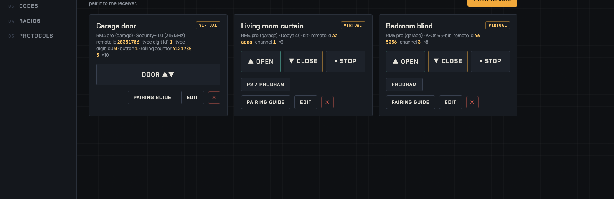
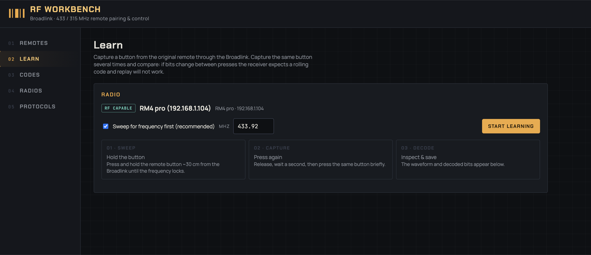

# RF Workbench

A small web app that turns a Broadlink RM pro / RM4 pro into a programmable RF remote for anything on 433 or 315 MHz: curtain motors, garage openers, fans, outlets. Learn codes from an original remote and replay them, or let the workbench **synthesise a brand-new remote** and pair it to the receiver the way a factory remote is paired. Rolling-code openers included.



## What it does

- **Virtual remotes.** The workbench generates a remote with its own random identity for a known protocol, you put the receiver in learn mode, press the button here, done. No capture of the original needed.
- **Rolling codes.** Security+ 1.0 (Chamberlain / LiftMaster / Craftsman garage openers, orange or red learn button, 315 MHz) is fully synthesised. The counter is stored and advanced on every press, so the opener keeps accepting it.
- **Learn & replay** for fixed-code remotes, with a pulse oscilloscope, PWM / Manchester decoding and a bit-by-bit comparison of several captures to tell fixed codes from rolling ones.
- **Plain HTTP API** for Home Assistant, scripts, anything.



### Protocols

| Protocol | Receivers | Band |
|---|---|---|
| Dooya 40-bit | Dooya tubular motors and rebadges (Acmeda, Zemismart, Rollerhouse, generic DC/DM) | 433.92 MHz |
| A-OK 65-bit | A-OK AC114 / AC123 remotes, AM-series motors, many projector screens and blinds | 433.92 MHz |
| Security+ 1.0 | Chamberlain / LiftMaster / Craftsman openers 2005–2011 (371LM / 373LM / 139.53753 remotes) | 315 MHz |

Not supported: purple-button openers (390 MHz, outside the Broadlink's bands), yellow-button Security+ 2.0, and encrypted curtain remotes such as Alpha WSRE303 (no public cipher).

## Running it

Native, the way that always works on macOS (Docker Desktop cannot pass the UDP traffic Broadlink devices use):

```bash
./run-local.sh            # http://localhost:8333, creates .venv on first run
PORT=8334 ./run-local.sh  # another port
```

Docker on a Linux box with host networking, so LAN discovery works:

```bash
docker compose up -d --build
```

Hosts without host networking: `docker compose -f docker-compose.yml -f docker-compose.ports.yml up -d` and add the Broadlink by IP in the Radios tab.

`deploy-nuc.sh` rsyncs the project to a Linux host (`NUC_HOST`, default `nuc.local`) and rebuilds the container there. It never overwrites the remote `data/store.json`, which is where the rolling-code counters live; `--data` does, on purpose.

The Broadlink must already be on Wi-Fi (set up once in the Broadlink app) and not locked in that app.

## Pairing a garage opener

1. Remotes → New remote → Virtual remote → Security+ 1.0. The identity and counter are randomised, keep the defaults, set Repeat to 10.
2. Put the Broadlink within a few metres of the motor head.
3. Press the opener's LEARN button, click **Door ▲▼** within 30 seconds, wait for the LEARN LED to go out.
4. Click **Door ▲▼**. The door moves. Each press cycles open → stop → close.

If the opener's light toggles instead of the door moving, the opener learned the remote as a *light* button: the type digit `id1` must be 1 for a door button (2 means light). Changing any digit is a new remote to the opener, so pair again. The exact meaning of these digits was found the hard way, see `backend/app/protocols/secplus1.py`.

Only one instance should drive a rolling-code remote. Two copies of the store means two counters, and whichever one falls behind gets ignored.

## API

```
GET  /api/remotes                               all remotes
POST /api/remotes/{id}/commands/{command}       press a button (open, close, stop, toggle, program, …)
GET  /api/codes · POST /api/codes/{id}/send      learned codes
POST /api/learn/start · GET /api/learn/status    capture from an original remote
GET  /api/protocols                             encoders, their fields and pairing steps
GET  /api/devices · POST /api/devices/discover   Broadlink radios
```

Home Assistant, as a REST command plus a template button:

```yaml
rest_command:
  garage_door:
    url: "http://<workbench-host>:8333/api/remotes/<remote id>/commands/toggle"
    method: post

template:
  - button:
      - name: "Garage door"
        press:
          - action: rest_command.garage_door
```

## Development

```bash
.venv/bin/pip install -r backend/requirements-dev.txt
.venv/bin/python -m pytest backend/tests -q
```

The Security+ 1.0 encoder is checked against reference vectors from [argilo/secplus](https://github.com/argilo/secplus); rtl_433 and the Flipper Zero use the same layout. Protocols live in `backend/app/protocols/`, one file each; add a class, register it in `__init__.py`, and the UI picks it up.
